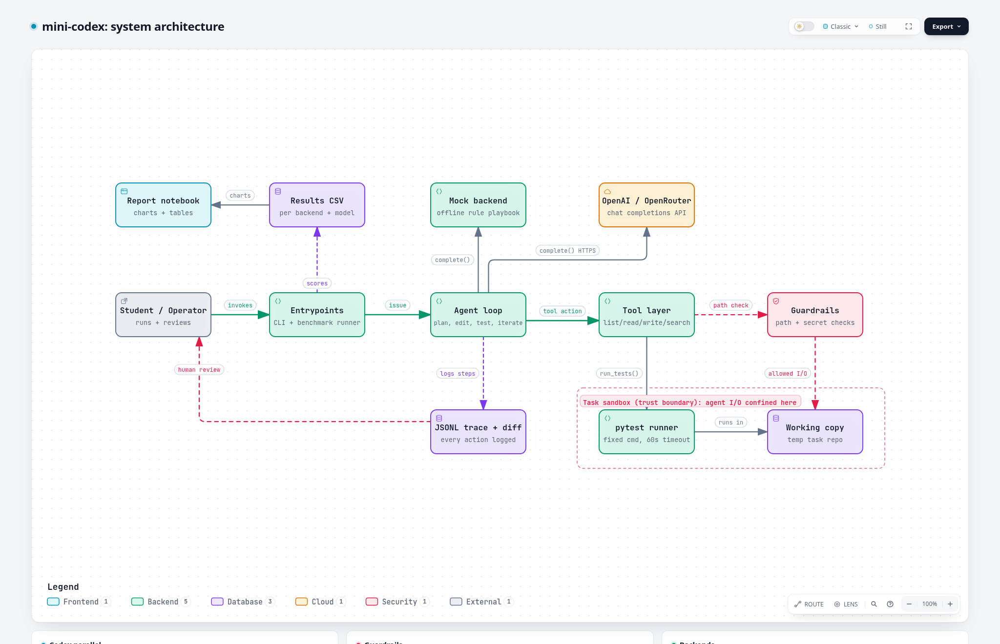
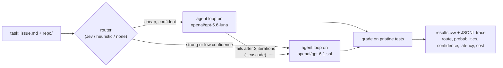
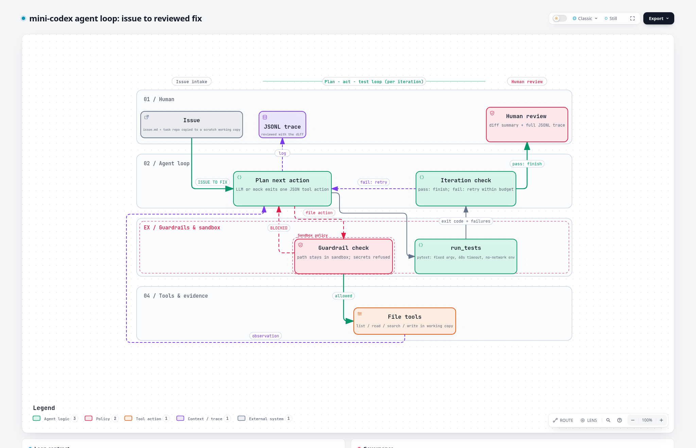
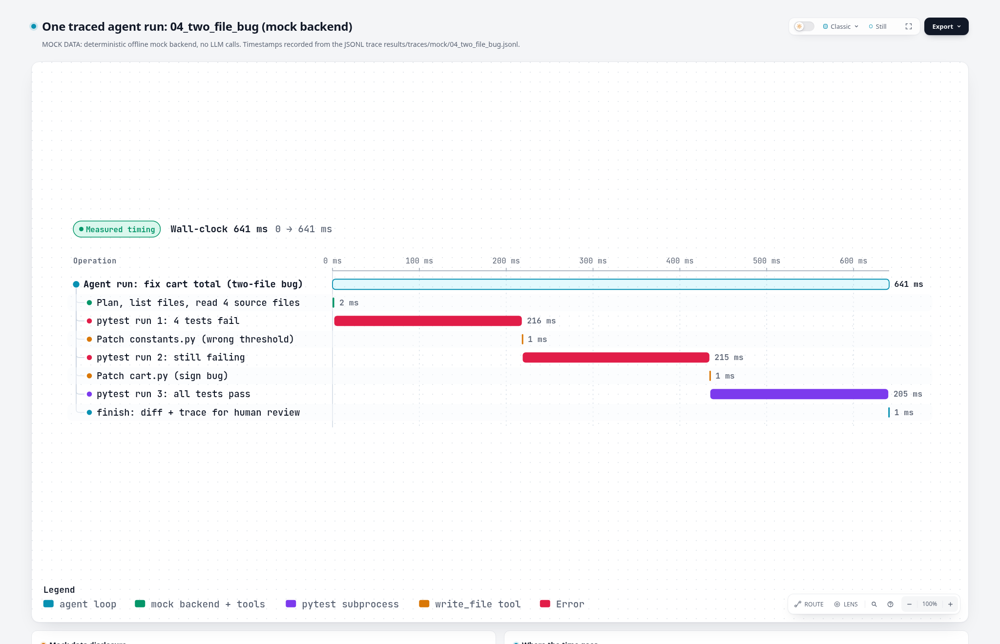

# mini-codex: a small, reproducible AI coding agent

Applied Project Component ("Mock AI Model Creation") for a UGA **MIST 7400E**
group report on **Cisco's enterprise deployment of OpenAI Codex**.

Cisco's Codex workflow hands an agent an issue. The agent plans, edits files, runs
the build and tests, reads the errors and iterates, inside a sandbox and with
humans reviewing the result. `mini-codex` is a scaled-down, fully inspectable
version of that loop. It adds the cost control an enterprise needs at scale:
**Jev** (TypeSafe's decision model) routes each task to a cheap or a strong model,
and a cascade escalates failures. The project is evaluated on 30 real bug-fix tasks
from HumanEvalFix plus 8 hand-written ones.

Everything runs offline with a deterministic mock backend. Real runs go through
OpenRouter.

## Quickstart

```bash
git clone https://github.com/srp8/G6.git && cd G6
python3 -m venv .venv && source .venv/bin/activate
pip install -e ".[notebook,dev]"

pytest -q                       # unit + end-to-end tests (offline)
ruff check .                    # lint

minicodex-bench --suite custom  # benchmark with the mock backend (offline)
minicodex --task benchmark/suites/custom/04_two_file_bug   # one task, with the review diff
jupyter notebook notebooks/benchmark_report.ipynb          # tables and charts
```

### Real models (OpenRouter) and the Jev router

```bash
cp .env.example .env            # fill in your keys; .env is git-ignored
set -a; source .env; set +a

# one task, routed by Jev
minicodex --task benchmark/suites/custom/04_two_file_bug --backend openai --router jev

# the four benchmark configurations reported below (3 repeats each)
minicodex-bench --backend openai --model openai/gpt-6.1-sol --repeat 3 --workers 6 --tag sol_full
minicodex-bench --backend openai --model openai/gpt-5.6-luna --repeat 3 --workers 6 --tag luna_full
minicodex-bench --backend openai --router jev --cascade --repeat 3 --workers 6 --tag jev_cascade_full
minicodex-bench --backend openai --model openai/gpt-6.1-sol --max-iterations 1 --repeat 3 --workers 6 --tag sol_noretry

minicodex-report                # -> results/summary.md, results/summary_by_suite.csv
```

Start with `--limit 3` for a smoke run. Use `--max-cost 5` to stop starting new
tasks once a run has spent $5.

### Benchmark runner flags

| Flag | Meaning |
|---|---|
| `--backend mock\|openai` | offline rule-based mock (default) or any OpenAI-compatible API |
| `--model ID` | model when not routing (default `openai/gpt-6.1-sol`) |
| `--suite custom\|humanevalfix\|all` | which tasks to run (default `all`) |
| `--limit N` | first N tasks of each suite |
| `--max-iterations N` | edit-and-test attempts per task (default 6; `1` = no-retry baseline) |
| `--router none\|jev\|heuristic` | per-task choice between `--cheap-model` and `--strong-model` |
| `--cascade` / `--cascade-after N` | start on the cheap model; after N failed iterations (default 2), retry from scratch on the strong model |
| `--confidence-threshold X` | a cheap pick below this router confidence goes to the strong model (default 0.6) |
| `--repeat N` | run every task N times (reliability) |
| `--workers N` | tasks in parallel |
| `--reasoning-effort low\|medium\|high` | reasoning effort for reasoning models (default: the provider's) |
| `--action-mode auto\|tools\|json` | native tool calling (auto when supported) or JSON actions |
| `--max-cost USD` | cost cap per run |
| `--tag NAME` | run label, so results go to `results/runs/NAME/` |

### Environment variables

Set them in `.env` (copy `.env.example`) or in your shell. Never commit real keys.

| Variable | Needed for | Meaning |
|---|---|---|
| `OPENAI_API_KEY` | `--backend openai` | provider key (an OpenRouter key for OpenRouter) |
| `OPENAI_BASE_URL` | OpenRouter | `https://openrouter.ai/api/v1` |
| `TYPESAFE_API_KEY` | `--router jev` | Jev key; without it the router falls back to the offline heuristic |
| `MINICODEX_BACKEND`, `MINICODEX_MODEL`, `MINICODEX_MAX_ITERATIONS`, `MINICODEX_REASONING_EFFORT` | optional | defaults for the matching flags |
| `MINICODEX_INPUT_COST_PER_M`, `MINICODEX_OUTPUT_COST_PER_M` | optional | price fallback when the provider does not report cost (OpenRouter does) |

## Architecture



The diagram above shows the core components. The routing layer added on top of them
looks like this:



| Component | File | Codex / Cisco counterpart |
|---|---|---|
| Agent loop: plan, read, edit, test, read failures, iterate | `minicodex/agent.py` | Codex working a task |
| Six tools: `list_files`, `read_file`, `write_file`, `search`, `run_tests`, `finish` | `minicodex/tools.py` | Codex's file edits and test commands |
| Backends: OpenAI-compatible (native tool calling, retries, reported cost) and an offline mock | `minicodex/backends/` | The model API |
| Router: Jev (TypeSafe), heuristic, or none, plus a cheap-to-strong cascade | `minicodex/router.py`, `minicodex/bench.py` | Enterprise model selection and spend control |
| Guardrails: sandboxed copy, no shell or network, secret files blocked, tests read-only | `minicodex/guardrails.py` | Codex sandbox, network off, approval policy |
| JSONL trace and a unified diff for review | `minicodex/trace.py` | Audit log and human code review |
| Benchmark runner, metrics and report | `minicodex/bench.py`, `metrics.py`, `report.py` | Deployment metrics and ROI tracking |

### The agent loop



Each turn, the model calls exactly one tool. On models that support it, this uses
native function calling with strict schemas and `parallel_tool_calls: false`.
Otherwise the agent falls back to a JSON action, constrained by a JSON schema where the
model supports structured outputs. The loop executes the tool through the guardrails,
logs it to the trace and returns the result. An **iteration** is one edit followed by
a test run, so a diagnostic test run before any edit is free. The loop stops when the
tests pass, the iteration budget is used up, the model finishes, or a step cap is hit.

Every attempt is then **graded on a pristine copy of the task's tests** and gets one
outcome label: solved, `wrong_fix`, `budget_exhausted`, `invalid_action`,
`guardrail_block` or `api_error`.

A traced run of the two-file task with the offline mock backend. The first fix
leaves the tests red, and the loop recovers on the second iteration. Sol behaves the
same way on this task in the real runs (2 iterations on every repeat).



### Routing with Jev

For each task, the router sends Jev the issue, the file list, size signals and a
source excerpt, with one **Choice** question: *cheap* (`openai/gpt-5.6-luna`,
$0.20/$1.20 per M tokens) or *strong* (`openai/gpt-6.1-sol`, $2/$10 per M). Jev
returns per-option probabilities and a confidence. Following TypeSafe's
routing-by-confidence pattern, the cheap model is used only for a confident cheap
pick; anything below the threshold goes to the strong model. With `--cascade`, a
cheap attempt that fails after two iterations is retried from scratch on the strong
model. Each decision is logged with its probabilities, confidence and latency, in
both the trace and the CSV. With no TypeSafe key, or if Jev errors, a deterministic
heuristic router takes over. Mock runs use a fake Jev client, so tests and demos stay
offline.

### Guardrails

- **Sandbox:** the agent works on a temporary copy of the task repo, and every path
  must resolve inside it (`../` escapes are blocked).
- **No shell, no network:** the only subprocess is `pytest` with a fixed command
  line, a 60-second timeout and a stripped environment (no API keys).
- **Secret hygiene:** `.env`, `*.pem`, `*.key`, `*credentials*`, `id_rsa` and similar
  files are hidden from `list_files` and blocked for reads and writes. Task `01` ships
  a decoy `.env`.
- **Read-only tests:** writes to `tests/`, `test_*.py` and `conftest.py` are blocked,
  and grading re-runs the original tests anyway.
- **Human review:** each run ends with a unified diff, and the JSONL trace records
  every model call, tool call, routing decision and test result.

## Dataset

38 tasks, about 80 KB in total, described in [DATASET.md](DATASET.md):

- **`humanevalfix` (30 tasks):** a fixed-seed (7400) sample of HumanEvalFix Python
  problems from `bigcode/humanevalpack` (MIT; Muennighoff et al., ICLR 2024). Each is a
  buggy function with its unit tests. Rebuild with
  `python scripts/build_humanevalfix.py --verify`.
- **`custom` (8 tasks):** hand-written seeded bugs, including a bug that spans two
  files, a feature request, and a secret-file decoy.

## Results

Real runs on 16 November 2026 through OpenRouter, using each model's default reasoning
effort. Every configuration ran all 38 tasks **3 times** (114 attempts). Full numbers are
in [results/summary.md](results/summary.md), per-attempt rows in
`results/runs/<config>/results.csv`, and charts in the
[notebook](notebooks/benchmark_report.ipynb) and [results/figures/](results/figures/).

| Configuration | Suite | pass@1 | Wilson 95% CI | Mean iterations | Cost per solved | Total cost |
|---|---|---|---|---|---|---|
| Sol only (`openai/gpt-6.1-sol`) | custom | 24/24 = 100% | 86.2–100% | 1.12 | $0.0100 | $0.2396 |
| | humanevalfix | 90/90 = 100% | 95.9–100% | 1.00 | $0.0125 | $1.1257 |
| | **all** | **114/114 = 100%** | 96.7–100% | 1.03 | **$0.0120** | $1.3654 |
| Luna only (`openai/gpt-5.6-luna`) | custom | 24/24 = 100% | 86.2–100% | 1.12 | $0.0012 | $0.0290 |
| | humanevalfix | 90/90 = 100% | 95.9–100% | 1.03 | $0.0015 | $0.1362 |
| | **all** | **114/114 = 100%** | 96.7–100% | 1.05 | **$0.0014** | $0.1651 |
| Jev-routed + cascade | custom | 24/24 = 100% | 86.2–100% | 1.04 | $0.0031 | $0.0745 |
| | humanevalfix | 90/90 = 100% | 95.9–100% | 1.00 | $0.0020 | $0.1762 |
| | **all** | **114/114 = 100%** | 96.7–100% | 1.01 | **$0.0022** | $0.2507 |
| Sol, no retry (`--max-iterations 1`) | custom | 21/24 = 87.5% | 69.0–95.7% | 1.00 | $0.0108 | $0.2278 |
| | humanevalfix | 90/90 = 100% | 95.9–100% | 1.00 | $0.0121 | $1.0888 |
| | **all** | **111/114 = 97.4%** | 92.5–99.1% | 1.00 | $0.0119 | $1.3166 |
| Luna, no retry | **all** | **111/114 = 97.4%** | 92.5–99.1% | 1.00 | $0.0014 | $0.1589 |

**What it shows**

- **Same quality, much lower cost with routing.** Every full-loop configuration solved
  every attempt. Jev routing cut the cost per fix from 1.20¢ (Sol only) to 0.22¢, which
  is 82% cheaper. Jev sent 107 of 114 attempts to Luna and 7 to Sol: the feature request
  3/3, `minPath` 3/3, and the two-file bug once, on low confidence. No cascade escalation
  was needed. Jev added about $0.004 in total, at a mean latency of 140 ms per decision.
  On this benchmark Luna alone was cheaper still (0.14¢). Routing paid for a few Sol calls
  that the task did not need, which is the price of insurance on harder tasks.
- **The test-and-retry loop matters for multi-step fixes.** One-shot patching failed the
  two-file bug on every repeat for both models, so custom fell from 100% to 87.5%
  (+12.5 pp from retrying; +2.6 pp overall), for about 4% more cost.
- **Failure taxonomy:** the only failures were `budget_exhausted` in the no-retry runs.
  There were no invalid actions, guardrail blocks, API errors or API retries in any real
  run.
- **Reliability:** every task had the same outcome in all 3 repeats, in every
  configuration.
- **Ceiling effect:** near-100% scores mean this benchmark cannot separate the models on
  quality (see Limitations).

The committed `mock_all` run is the offline reference: the rule-based mock solves 7/8
custom tasks and 0/30 HumanEvalFix tasks, which is expected because its playbook only
knows the custom bugs.

Total API spend for the runs above was **$3.26** (OpenRouter's reported cost, plus Jev),
or about $3.40 including smoke tests, as shown by OpenRouter's `/api/v1/key` usage
counter.

## Repo layout

```
minicodex/              the package
  agent.py              the edit-test-fix loop and failure classification
  tools.py              tools and their JSON schemas
  guardrails.py         sandbox, secret blocking, read-only tests, review diff
  router.py             Jev, heuristic and no-op routers
  bench.py              benchmark runner (minicodex-bench)
  metrics.py, report.py Wilson CIs, failure taxonomy, reliability, summary
  backends/             OpenAI-compatible and mock backends
  cli.py                one task from the command line (minicodex)
benchmark/suites/       custom/ and humanevalfix/ task repos
scripts/                build_humanevalfix.py
notebooks/              benchmark_report.ipynb
results/                runs/<label>/ (CSV, config, traces), summary.md, figures/
docs/                   diagrams/, REFERENCES.md, REQUIREMENTS_TRACE.md
tests/                  offline tests (mocked OpenRouter and Jev)
```

## Limitations

- **Contamination and ceiling effects:** HumanEval problems have been public since
  2021 and are very likely in the models' training data. High solve rates show that
  the loop works end to end. They don't show the agent can fix bugs in unfamiliar
  enterprise code, and near-100% scores leave little room to separate configurations.
- **Scale:** single-function and two-file repos, compared with Cisco's large,
  multi-service codebases. There is one test runner (pytest), not builds, linters and
  security scanners.
- **Small samples:** 38 tasks × 3 repeats still give wide intervals. Repeats of the
  same task aren't independent, so the CIs treat attempts as independent and are
  somewhat optimistic.
- **Routing signal:** Jev sees the issue and a source excerpt, not how hard the fix
  turned out to be. The 0.6 confidence threshold and the cascade budget were not tuned.
- **Cost accounting:** costs are OpenRouter's billed amounts at November 2026 prices,
  plus Jev's list price for its input tokens. Cached-token discounts make
  repeated runs slightly cheaper than a cold run.
- **Security depth:** guardrails are illustrative (path checks, filename patterns, no
  shell). Enterprise controls add network isolation, DLP, secret scanning of diffs and
  provenance tracking.
- **One agent at a time:** no parallel agents, SSO, quotas or policy management.

## References

The API docs, design guides and papers used are listed in
[docs/REFERENCES.md](docs/REFERENCES.md). The mapping from the course guidelines to
this repo, plus a demo run-of-show, is in
[docs/REQUIREMENTS_TRACE.md](docs/REQUIREMENTS_TRACE.md).
